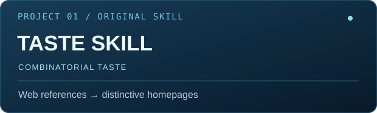
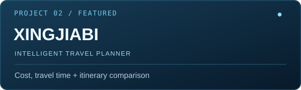
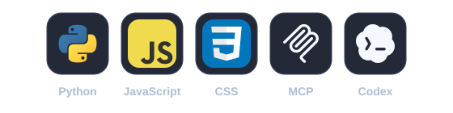

<picture>
  <source media="(prefers-reduced-motion: reduce)" srcset="assets/hero-preview.png" />
  
</picture>

### AI Product Builder + Crypto

把想法做成产品。 / Turning ideas into products.

Vancouver · 上海 / Shanghai

<table><tr>
<td width="50%"></td>
<td width="50%"></td>
</tr></table>

- **[原创 Taste Skill / Combinatorial Taste](https://github.com/Chrischou920-spec/combinatorial-taste-skill)** — 从网页参考中组合设计方法，设计或实现有自身辨识度的首页。 / An original Skill that combines methods from website references to design or implement distinctive homepages.
- **[行价比 / Xingjiabi](https://github.com/Chrischou920-spec/xingjiabi)** — 接入 12306 与国内航班 MCP，比较单程与往返出行方案。 / A local trip planner with 12306 and domestic-flight MCP integrations for one-way and round-trip comparison.

---

### contribution snake

<picture>
  <source media="(prefers-color-scheme: dark)" srcset="assets/github-snake-dark.svg" />
  <source media="(prefers-color-scheme: light)" srcset="assets/github-snake.svg" />
  
</picture>

---

### stacks

---

### connect

[X · @Chr1sss630](https://x.com/Chr1sss630) · [Email · chrischou630@gmail.com](mailto:chrischou630@gmail.com)

